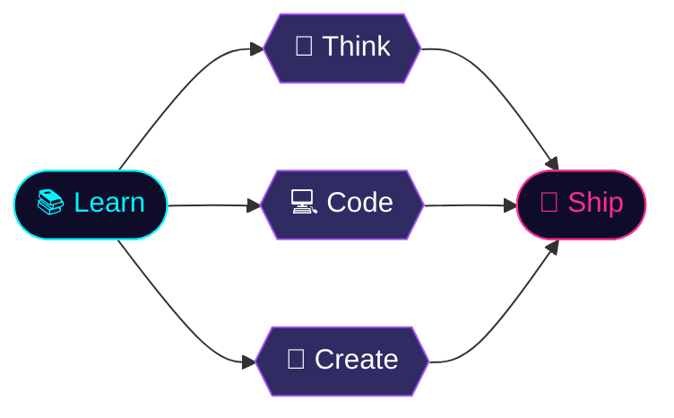

<div align="center">


<a href="https://git.io/typing-svg">
  
</a>

<p><i>"Turning algorithms and creative logic into seamless digital experiences."</i></p>


</div>

<br/>

## 🧠 `> whoami`

```python
class Navid:
    def __init__(self):
        self.name       = "Omar Ridhwan Navid"
        self.role       = "Software Developer & IT Student"
        self.university = "Politeknik Caltex Riau (PCR) 🇮🇩"
        self.interests  = ["Software Engineering", "Interactive UI", "Procedural 3D", "AI"]
        self.fuel       = ["Running 🏃‍♂️", "Cycling 🚴‍♂️", "Formula 1 🏎️"]

    def mission(self):
        return "Turn algorithms into seamless digital experiences."
```

<br/>

## 🔭 Neural Pipeline



<br/>

## ⚙️ Active Modules

| 🧩 Module | 📡 Description |
| :--- | :--- |
| 🎓 **Studying** | Data Structures (Java), Framework Programming, Human-Computer Interaction, Linear Algebra (Gauss-Jordan & matrix proofs) |
| 🛒 **Building** | A framework-based e-commerce platform for a sneaker culture store (*26 Store Pekanbaru*) with inventory management & limited-edition drops |
| 🎨 **Experimenting** | Procedural 3D scripting in **Blender 3.6** via Python `bpy`: low-poly environments, jogging tracks & urban parks |
| 🤖 **Exploring** | AI-assisted development, prompt engineering & applying machine learning ideas to real projects |

<br/>

## 🛠️ Tech Stack

<div align="center">


<br/><br/>


</div>

<br/>

## 🎯 Mission Objectives

| 💻 Technical Goals | 🏃‍♂️ Personal Goals |
| :--- | :--- |
| 🏗️ Build robust checkout systems & clearance sale logic for e-commerce | 🏅 Complete my 52-week Half-Marathon program (sub-2:00) |
| 🌳 Procedurally generate 3D basketball courts & calisthenics parks | 🏋️‍♂️ Keep a weekly push/pull strength & bodyweight routine |
| 📊 Manage class finance tracking, ledgers & transaction verification | 🚴‍♂️ Stay consistent with outdoor cycling cross-training |

## 👾 Contribution Pac-Man

<div align="center">

<picture>
  <source media="(prefers-color-scheme: dark)" srcset="https://raw.githubusercontent.com/NavidOmar-437/NavidOmar-437/output/pacman-contribution-graph-dark.svg" />
  <source media="(prefers-color-scheme: light)" srcset="https://raw.githubusercontent.com/NavidOmar-437/NavidOmar-437/output/pacman-contribution-graph.svg" />
  
</picture>

</div>

<br/>

## 📫 Establish Connection

<div align="center">

<a href="mailto:omarridhwan437@gmail.com">
  
</a>
<a href="https://linkedin.com/in/OmarRidhwanNavid">
  
</a>

<br/><br/>


</div>
